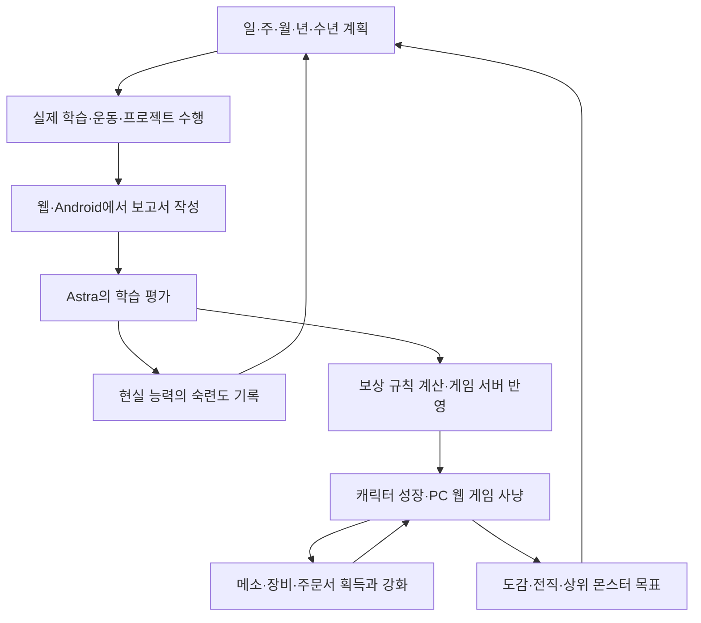
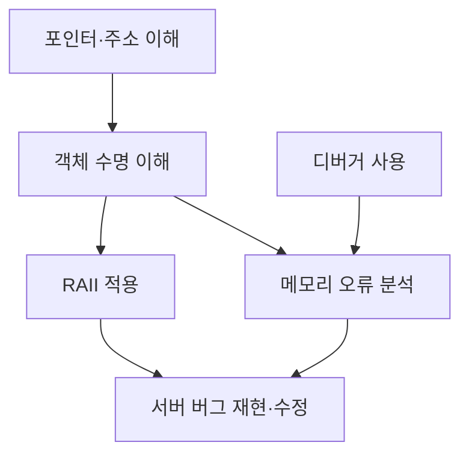

# 학습 연동 메이플 RPG — 설계 지도 v0.1

**원작 메이플의 사냥·레벨업·전직·장비 강화 경험을 유지하면서, 실제로 공부하고 성장한 결과가 게임 속 캐릭터의 성장으로 이어지는 게임**입니다.

웹·Android에서 계획을 세우고 활동을 기록하며, PC에서는 독립적인 웹 게임으로 사냥합니다. 장기적으로는 **“내 CS 실력이 성장한 만큼 예전에 잡지 못했던 몬스터를 잡게 되는 경험”**을 만드는 것이 중심입니다.

아래에서는 현재 상태를 세 가지로 구분했습니다.

- **확정 방향:** 직접 원한다고 밝힌 요구사항.
- **설계 제안:** 앞선 대화에서 추천한 구현 방식. 아직 최종 선택한 것은 아님.
- **미정:** 앞으로 구체적인 규칙이나 수치를 정해야 하는 부분.

---

## 1. 제품의 기본 방향

| 항목 | 현재 설계 방향 | 상태 |
|---|---|---|
| 핵심 경험 | 어린 시절 메이플에 몰입했던 경험을 자기계발과 연결 | 확정 방향 |
| 게임 형태 | 실제 사냥·성장·수집·장비 강화가 있는 RPG | 확정 방향 |
| 기록 환경 | 웹·Android에서 학습, 운동, 활동 보고서 작성 | 확정 방향 |
| 플레이 환경 | PC에서 사냥하는 A 모델. 독립적인 웹 게임으로 운영 | 확정 방향 |
| 진행도 공유 | 동일 계정의 학습 기록과 게임 진행도를 기기 간 공유 | 확정 방향 |
| 개발 방식 | 서버와 클라이언트를 직접 수정 | 확정 방향 |
| 원작 대응 | 원작의 몬스터·아이템·스킬·리소스를 최대한 그대로 대응 | 확정 방향 |
| 성장 분야 | CS, 운동, 영어 어휘·읽기·듣기·말하기·쓰기 등 | 확정 방향 |
| 계획 기능 | 일·주·월·년·수년 계획을 만들고 지속적으로 수정 | 확정 방향 |
| 평가 방식 | 일일 보고서를 Astra Ultra가 평가하고 결과를 서버에 반영 | 확정 방향 |

여기서 **원작 콘텐츠를 일대일로 대응시키는 것**과 **CS 능력 하나를 메이플 스킬 하나에 연결하는 것**은 별도로 정해야 합니다. 전자는 제품의 지향점이고, 후자의 정확한 연결 방식은 아직 미정입니다.

---

## 2. 전체 순환 구조

아래는 앞선 권장안을 기준으로 묶은 전체 흐름입니다.

이 구조에는 서로 연결되는 두 가지 성장이 있습니다.

| 성장 | 실제로 쌓이는 것 | 사용자가 확인하는 것 |
|---|---|---|
| **현실의 성장** | 지식, 구현 능력, 문제 해결 능력, 언어 능력, 운동 수행 기록 | 분야별 능력과 숙련도, 평가 근거 |
| **게임의 성장** | 경험치, 레벨, AP·SP, 전직, 장비, 메소, 도감 | 캐릭터 능력치, 공격력, 잡을 수 있는 몬스터 |

**학습 평가 결과를 어떤 게임 성장으로 변환할지가 두 영역을 연결하는 핵심 규칙**입니다.

---

## 3. 게임 시스템 지도

### 3-1. 유지할 핵심 시스템

| 시스템 | 의도한 경험 | 아직 정해야 하는 부분 |
|---|---|---|
| 레벨업 | 공부와 활동의 성과가 캐릭터 성장으로 누적 | 학습 경험치와 사냥 경험치의 비중 |
| STR·DEX·INT·LUK | 익숙한 캐릭터 스탯과 육성 감각 | 학습 분야와의 연결 방식, AP 지급·배분 |
| 공격력 | 장비와 스탯이 실제 사냥 성능에 영향 | 원작 계산식을 어느 정도 유지할지 |
| 사냥 | 성장한 캐릭터로 더 강한 몬스터 처치 | 학습 수준과 몬스터 난도의 연결 |
| 메소 | 사냥으로 획득하고 구매·성장에 사용 | 수급량, 소비처, 경제 균형 |
| 장비·템셋 | 무기와 장비를 모으고 조합하며 성장 | 원작 장비 체계의 적용 범위 |
| 주문서 강화 | 일정 확률로 성공·실패하는 긴장감 | 확률, 실패 시 처리, 강화 제한 |
| 물약·상점 | 사냥에 필요한 물품과 더 좋은 장비 구매 | 가격, 회복량, 구매 조건 |
| 몬스터 도감 | 처치와 수집의 누적 성취 | 등록 조건과 보상 |
| 전직 | 1~4차로 이어지는 큰 성장 단계 | 레벨·학습·성과물 조건 |
| 스킬 | SP 투자와 육성 선택 | CS 능력과의 연결 방식 |
| 유니온 | 여러 분야의 성장을 함께 보여주는 장기 구조 | 분야별 캐릭터 구성과 보너스 |

### 3-2. 랜덤성은 실제 전투력에 영향을 준다

이 부분은 확정된 방향입니다.

| 랜덤 요소 | 게임에서 얻는 결과 |
|---|---|
| 몬스터 드롭 | 메소·장비·아이템·주문서 획득 |
| 주문서 획득 | 다음 강화를 시도할 기회 |
| 주문서 사용 | 확률에 따른 강화 성공·실패 |
| 장비 성장 | 공격력과 사냥 성능 변화 |
| 좋은 아이템 획득 | 새로운 템셋과 상위 사냥 목표 |

**학습 성과로 성장한 캐릭터가 사냥하고, 사냥에서 얻은 자원과 운으로 다시 강해지는 구조**입니다.

현실의 CS 숙련도는 수행 증거를 기준으로 평가하고, 아이템 드롭과 강화의 확률은 게임 서버가 처리하는 방식을 권장했습니다.

### 3-3. 몬스터는 장기 성장의 체감 기준

사용자가 제시한 성장 이미지는 다음과 같습니다.

| 성장 구간의 이미지 | 몬스터 예시 | 느끼고 싶은 변화 |
|---|---|---|
| 시작 | 파란달팽이 | 처음 공부한 내용이 성장으로 연결됨 |
| 기초 축적 | 주황버섯 | 초반보다 확실히 강해짐 |
| 장기 성장 | 스톤볼 | 공부와 육성의 누적 성과가 드러남 |
| 더 높은 목표 | 스톤골렘 | 예전에 불가능했던 상대를 처치함 |

이 표는 **목표 이미지**입니다. “공부 몇 시간 = 특정 몬스터 처치”, “2년 = 스톤골렘”이라는 환산식은 아직 정하지 않았습니다.

실제 도달 시점은 학습 보상, 전직 조건, 장비 성장, 몬스터 난도를 함께 조정하면서 맞춰야 합니다.

---

## 4. 전직·스킬·SP 설계

### 4-1. 1~4차 전직

**1~4차 전직의 개념을 유지하는 것이 확정 방향**입니다.

전직을 큰 성장 이정표로 사용하되, 다음 세부 조건은 아직 미정입니다.

- 원작의 전직 레벨을 그대로 사용할지.
- 전직에 특정 학습 능력이나 프로젝트 완료를 요구할지.
- 직업별로 CS·영어·운동 분야를 연결할지.
- 전직 시 어떤 보상과 새로운 콘텐츠를 제공할지.

### 4-2. “스킬 해금은 4차에서만”의 현재 해석안

앞선 답변에서는 다음 방식으로 해석했습니다.

| 구간 | 제안한 스킬 제공 방식 |
|---|---|
| 1차 | 전직 시 해당 스킬 목록을 제공하고, SP로 습득·강화 |
| 2차 | 전직 시 해당 스킬 목록을 제공하고, SP로 습득·강화 |
| 3차 | 전직 시 해당 스킬 목록을 제공하고, SP로 습득·강화 |
| 4차 | 일부 스킬에 별도 습득 조건이나 해금 과제를 적용 |

즉, 현재 설계 제안은 **“개별 스킬을 얻기 위한 추가 조건을 4차에 집중한다”**는 것입니다. 이것은 사용자의 선호를 구현하기 위한 해석안이며, 해금 대상과 범위는 최종 확정이 필요합니다.

### 4-3. 스킬에서 구분할 세 가지 상태

| 상태 | 의미 |
|---|---|
| **사용 가능 여부** | 해당 스킬에 접근하고 SP를 투자할 수 있는가 |
| **현재 스킬 레벨** | 실제로 SP를 얼마나 투자했는가 |
| **마스터 상한** | 현재 최대 몇 레벨까지 올릴 수 있는가 |

이 구분을 두면 4차에서 다음과 같은 보상을 각각 설계할 수 있습니다.

- 새 스킬 습득.
- 기존 스킬의 투자 상한 확대.
- 특정 숙련도나 과제 달성에 따른 추가 성장 기회.

### 4-4. 해금 퀘스트의 구현 구조

스킬마다 완전히 다른 프로그램을 작성하는 대신, **공통 조건 평가기와 스킬별 조건 데이터**를 두는 방식을 제안했습니다.

| 스킬별 설정 항목 | 내용 |
|---|---|
| 필요한 학습 능력 | 어떤 CS 능력 등을 요구하는가 |
| 필요한 숙련도 | 어느 수준까지 수행해야 하는가 |
| 필요한 증거 | 코드, 설명, 테스트, 프로젝트 등 |
| 해금 보상 | 어떤 게임 스킬을 제공하는가 |
| 추가 효과 | 마스터 상한 변경 등 |

조건을 확인하고 보상을 주는 코드는 재사용할 수 있습니다. 각 능력에 맞는 평가 기준과 과제 내용은 별도로 만들어야 합니다.

학습 측면에서는 **해금 조건에 들어가는 설명·구현·응용 과제가 의미 있게 구성되는 것**을 중심으로 설계합니다. 학습 자료에 접근하는 것과 게임 보상을 해금하는 것은 별도로 관리하는 권장안입니다.

### 4-5. 레벨업당 SP 3

**레벨업 시 SP 3 지급을 유지하는 설계가 가능합니다.** 현재는 사용자가 유지 가능성을 물었고, 앞선 답변에서 유지하는 방향을 추천한 상태입니다.

| 항목 | 권장안 |
|---|---|
| 기본 지급 | 레벨업 시 SP 3 |
| SP 사용 | 사용자가 직접 스킬을 선택해 투자 |
| 세부 규칙 | 초보자·직업별 예외·전직 추가 지급 등은 별도 확인 |
| 학습 평가와 관계 | 학습 보상이 게임 성장으로 이어지고, 게임의 성장 규칙이 SP 지급을 처리 |

---

## 5. 현실 능력·CS 스킬 트리·유니온

### 5-1. 현실 능력과 게임 수치를 연결하는 권장안

앞선 답변에서는 다음과 같이 계산 기준을 나누는 방식을 추천했습니다.

| 구분 | 표현하는 것 | 예시 |
|---|---|---|
| 캐릭터 레벨 | 누적된 게임 성장 | 레벨, 경험치 |
| 전투 능력치 | 게임에서의 성능 | STR·DEX·INT·LUK, 공격력 |
| 현실 숙련도 | 특정 능력을 실제로 수행하는 수준 | C++ 메모리 오류 분석 3/4 |
| 장비 성장 | 사냥·수집·강화의 결과 | 강화 무기, 템셋 |
| 성취 기록 | 달성한 활동과 목표 | 프로젝트 완료, 도감 등록 |

한 화면에서 함께 보여주되, **각 숫자가 무엇을 의미하는지 명확하게 유지하는 구조**입니다.

### 5-2. CS 스킬 최대 레벨 4

사용자가 검토한 “CS 스킬당 최대 레벨 4”에 대해서는 **현실 숙련도를 4단계로 평가하는 모델**을 추천했습니다.

| 단계 | 판정 기준 |
|---|---|
| 미측정 | 아직 판단할 증거가 충분하지 않음 |
| 1 | 개념을 자신의 말로 설명할 수 있음 |
| 2 | 익숙한 문제에 독립적으로 적용할 수 있음 |
| 3 | 새로운 조건이나 변형된 문제에 적용할 수 있음 |
| 4 | 시간이 지난 뒤에도 다시 수행하고 설명할 수 있음 |

이 권장안에서는 다음 두 체계를 함께 사용합니다.

- **메이플 전투 스킬:** 원래의 SP 투자와 스킬 레벨 구조.
- **CS 능력:** 수행 증거를 기준으로 하는 숙련도 1~4.

두 체계를 구분하는 이유는 포인트의 의미가 다르기 때문입니다. 예를 들어 20번의 레벨업으로 받은 60 SP는 최대 4레벨짜리 노드 15개를 채울 수 있지만, 그 사실만으로 15개 능력을 모두 익혔다고 판단할 수는 없습니다.

**CS 숙련도와 전투 스킬을 어떤 방식으로 연결할지는 아직 미정**입니다.

### 5-3. CS 트리 구성

CS 트리는 **평가할 수 있는 실제 능력을 노드로 만들고, 필요한 선수 능력을 연결하는 방식**을 제안했습니다.

예시는 다음과 같습니다.

각 노드는 다음 정보를 가집니다.

| 정보 | 내용 |
|---|---|
| 능력 이름 | 무엇을 할 수 있어야 하는가 |
| 선수 능력 | 어떤 지식이나 기술이 필요한가 |
| 숙련도 기준 | 1~4단계를 어떻게 판정하는가 |
| 수행 증거 | 설명, 코드, 테스트, 재현 기록 등 |
| 최근 평가 | 언제 어떤 근거로 평가했는가 |
| 게임 연결 | 경험치·전직·4차 해금 등에 어떻게 반영되는가 |

노드 수는 평가 가능한 능력의 수에 맞춥니다. 단순히 SP를 소비할 곳을 늘리기 위해 세분화하는 방식은 추천하지 않았습니다.

### 5-4. 게임 자체를 CS 학습 과제로 활용

원하는 경험을 가장 직접적으로 만드는 방법 중 하나는 **플레이하는 게임의 내부를 학습 대상으로 삼는 것**입니다.

| 게임에서 궁금해지는 것 | 연결할 CS 활동 |
|---|---|
| 주문서는 어떻게 성공·실패하는가 | 확률 처리와 난수 코드 분석 |
| 몬스터를 잡으면 아이템이 어떻게 나오는가 | 처치 이벤트부터 드롭 지급까지 코드 추적 |
| 아이템이 어디에 저장되는가 | 인벤토리와 저장 로직 분석 |
| 특정 상황에서 서버가 왜 오류를 내는가 | 버그 재현, 디버깅, 수정 |
| 웹에서 내 캐릭터를 어떻게 확인하는가 | 조회 API와 화면 구현 |

이때 수행한 작업과 결과물을 보고서에 넣고, 해당 CS 능력의 성장 근거로 사용합니다.

### 5-5. 다른 분야와 유니온

| 분야 | 세부 능력 예시 |
|---|---|
| CS | 프로그래밍, 자료구조, 운영체제, 네트워크, 데이터베이스, 디버깅 |
| 영어 | 어휘, 읽기, 듣기, 말하기, 쓰기 |
| 운동 | 종목별 수행 기록, 수행 능력, 지속성 |

**분야별 캐릭터를 두고 유니온으로 묶는 구성은 앞선 추천안**입니다.

예를 들어 CS 캐릭터, 영어 캐릭터, 운동 캐릭터의 성장을 함께 보여줄 수 있습니다. 다음 사항은 아직 정하지 않았습니다.

- 분야별로 캐릭터를 분리할지, 한 캐릭터에 여러 능력을 모을지.
- 분야별 캐릭터를 어떤 직업과 연결할지.
- 유니온이 어떤 게임 보너스를 줄지.
- 몬스터 도감과 별도로 지식·학습 도감을 둘지.

---

## 6. 계획 시스템

### 6-1. 시간 범위

| 시간 범위 | 계획의 역할 | 예시 |
|---|---|---|
| 일 | 오늘 실행할 활동 | 메모리 오류 하나 재현하기 |
| 주 | 짧은 단위의 결과 만들기 | 원인 분석과 수정 완료 |
| 월 | 하나의 기능이나 학습 단위 완성 | 작은 서버 기능 구현 |
| 년 | 큰 역량과 프로젝트 목표 | CS 기반과 서버 수정 능력 축적 |
| 수년 | 장기적인 성장 방향 | 원하는 수준의 개발 능력과 게임 성장 달성 |

예시는 설명용이며, 실제 목표를 이렇게 확정한 것은 아닙니다.

### 6-2. 계획과 기록의 관계

권장 구조는 다음과 같습니다.

- 수년 목표 아래에 연간 목표를 연결합니다.
- 연간 목표를 월·주·일 단위의 실행 계획으로 나눕니다.
- 실제 수행 결과는 보고서로 남깁니다.
- 평가 결과와 진행 상황을 보고 다음 계획을 수정합니다.
- 계획의 변경 이력과 과거 수행 기록을 함께 보존합니다.

**계획은 앞으로 할 일이고, 보고서는 이미 한 일**입니다. 계획을 수정할 때도 기존의 수행·평가·보상 이력을 추적할 수 있게 만드는 방향입니다.

게임에서는 이를 일일 퀘스트, 주간 목표, 장기 전직 목표, 상위 몬스터 도전 목표 등으로 표현할 수 있습니다.

---

## 7. 일일 보고서 → AI 평가 → 서버 반영

### 7-1. 보고서 입력

사용자가 입력하는 최소 항목으로 다음 네 가지를 제안했습니다.

| 항목 | 입력 내용 |
|---|---|
| 오늘 한 일 | 공부·운동·구현·연습 내용 |
| 혼자 해낸 것 | 도움 없이 설명하거나 수행한 내용 |
| 도움받거나 막힌 부분 | 참고한 자료, AI 도움, 해결하지 못한 문제 |
| 결과물 | 코드, 글, 테스트 결과, 녹음, 수행 기록 등 |

소요 시간과 관련 계획·퀘스트도 함께 연결할 수 있습니다.

### 7-2. 처리 단계

| 단계 | 처리 내용 |
|---|---|
| ① 보고서 저장 | 사용자와 활동을 식별할 수 있게 기록 |
| ② 능력 연결 | 보고서 내용이 어떤 CS·영어·운동 능력과 관련되는지 판단 |
| ③ 수행 평가 | 설명·독립 수행·응용 등의 증거 확인 |
| ④ 숙련도 판정 | 변화 여부와 판정 근거 기록 |
| ⑤ 게임 보상 계산 | 정해진 규칙으로 경험치 등 계산 |
| ⑥ 게임 서버 반영 | 서버의 정상적인 성장 처리로 보상 적용 |
| ⑦ 진행도 공유 | 웹·Android·PC에서 갱신된 결과 확인 |

### 7-3. AI와 서버의 역할

사용자가 제시한 원안은 **“AI가 어떤 능력치를 얼마나 올릴지 판단하고 서버에 전달한다”**는 것입니다.

이에 대해 앞선 답변에서 추천한 역할 분담은 다음과 같습니다.

| 담당 | 권장 역할 |
|---|---|
| **AI** | 무엇을 했는지 해석하고, 관련 능력·수행 수준·평가 근거를 판정 |
| **보상 규칙** | 판정 결과를 경험치 등 게임 보상으로 환산 |
| **게임 서버** | 경험치·레벨업·AP·SP·전직·아이템 상태 처리 |
| **사용자** | AP·SP 배분, 장비 선택, 강화, 사냥 목표 선택 |
| **게임의 확률 처리** | 드롭과 강화 성공·실패 결정 |

이 역할 분담은 **설계 제안**입니다. AI가 증가량까지 어느 정도 직접 결정하도록 할지는 아직 최종 확정하지 않았습니다.

평가 모델은 사용자가 지정한 **Astra Ultra**를 기준으로 구상하며, 실제 연동에 사용할 API 모델과 추론 설정은 구현 단계에서 고정할 항목입니다.

### 7-4. 자동 반영을 위한 기록 규칙

정상적인 보고서는 자동으로 처리하는 흐름을 목표로 하되, 다음 정보를 남기는 방식을 제안했습니다.

| 기록 | 필요한 이유 |
|---|---|
| 보고서 고유 ID | 여러 기기에서 재전송해도 중복 보상을 막기 위해 |
| 평가 근거 | 왜 숙련도나 보상이 바뀌었는지 확인하기 위해 |
| 적용한 규칙 버전 | 보상 기준이 바뀐 뒤에도 과거 결과를 설명하기 위해 |
| 보상 처리 이력 | 서버에 실제 반영되었는지 확인하기 위해 |
| 수정·정정 이력 | 보고서 편집이나 평가 수정 시 차이를 처리하기 위해 |

---

## 8. 기술 구성 지도

### 8-1. 필요한 구성요소

| 구성요소 | 맡는 역할 | 현재 상태 |
|---|---|---|
| 웹 기록 화면 | 계획, 일일 보고서, 능력치·진행도 조회 | 구현 필요 |
| Android 앱 | 휴대전화에서 같은 기능 사용 | 구현 방식 미정 |
| 공통 계정 | 학습 기록과 게임 캐릭터 연결 | 설계 필요 |
| 학습·계획 서버 | 목표, 보고서, 평가, 숙련도 관리 | 구현 필요 |
| AI 평가 모듈 | 보고서 분석과 능력 판정 | 구현 필요 |
| 보상 규칙 모듈 | 평가 결과를 게임 보상으로 변환 | 구현 필요 |
| 게임 연동 모듈 | 보상을 게임 서버에 안전하게 전달 | 구현 필요 |
| 수정한 게임 서버 | 전투, 성장, 전직, 스킬, 아이템, 확률 처리 | Cosmic 등 검토 |
| PC 웹 클라이언트 | 브라우저에서 실제 플레이 | 공개 클라이언트·브라우저 포트 검토 |
| 진행도 조회 기능 | 학습 상태와 게임 상태를 함께 표시 | 구현 필요 |

### 8-2. 앞서 검토한 코드 후보

| 후보 | 활용을 검토한 부분 |
|---|---|
| [Cosmic](https://github.com/P0nk/Cosmic) | 게임 서버의 기반 |
| [MapleStory-Client](https://github.com/ryantpayton/MapleStory-Client) | 수정 가능한 클라이언트 기반 |
| [maplestory-wasm](https://github.com/nmnsnv/maplestory-wasm) | PC 브라우저 플레이를 위한 포트 기반 |

현재는 **후보를 검토한 단계**입니다. 사용할 버전, 실제 기능 완성도, 서버·클라이언트 조합, 학습 기능과의 연결은 아직 구현·검증하지 않았습니다.

원작 리소스의 사용·배포 조건은 코드의 오픈소스 라이선스와 별도로 확인할 항목으로 남아 있습니다.

### 8-3. 데이터의 기준 위치

| 데이터 | 기준이 되는 곳 |
|---|---|
| 계획·보고서·평가 근거 | 학습 시스템 |
| CS 등 현실 능력의 숙련도 | 학습 시스템 |
| 지급할 보상과 지급 이력 | 보상 시스템 |
| 캐릭터 레벨·AP·SP | 게임 서버 |
| 메소·장비·인벤토리·강화 결과 | 게임 서버 |
| 여러 기기에 표시할 진행도 | 각 시스템의 상태를 묶어 제공하는 조회 기능 |

기기 간 동기화는 **동일 계정에 연결된 서버 상태를 공유하는 방식**으로 구성합니다.

---

## 9. 아직 결정하지 않은 핵심 규칙

다음 항목들이 실제 게임의 성격을 가장 크게 바꿉니다.

| 우선순위 | 결정할 항목 | 현재 남은 질문 |
|---|---|---|
| **1** | **학습 경험치와 사냥 경험치의 관계** | 각각 얼마나 지급할 것인가? 학습 없이 사냥만 하면 어디까지 성장할 수 있는가? |
| **2** | **현실 능력과 게임 성장의 연결** | CS 숙련도가 경험치·스탯·전직·스킬·사냥터 중 무엇에 영향을 주는가? |
| **3** | **CS 숙련도 4단계와 원작 스킬의 관계** | 별도 수치로 보여줄 것인가? 특정 전투 스킬이나 마스터 상한과 연결할 것인가? |
| **4** | **전직과 4차 해금 조건** | 각 전직에 무엇을 요구하며, 어떤 4차 스킬에 추가 조건을 둘 것인가? |
| **5** | **AI의 숫자 결정 권한** | AI가 증가량을 직접 정할 것인가, 판정 결과를 고정 규칙으로 환산할 것인가? |
| **6** | **장기 성장 속도와 경제** | 몬스터 도달 속도, 메소 수급, 드롭률, 강화 확률을 어떻게 맞출 것인가? |
| **7** | **다분야 캐릭터 구성** | CS·영어·운동을 각각의 캐릭터로 만들 것인가? 유니온 보너스는 무엇인가? |
| **8** | **기술 기반 확정** | 어떤 서버·클라이언트 버전을 기준으로 수정하고 브라우저 기능을 완성할 것인가? |

**다음 상세 설계에서는 ① 학습·사냥 경험치의 관계, ② CS 능력과 게임 성장의 연결, ③ 전직·4차 해금 조건을 먼저 고정하는 순서가 적절합니다.** 이 세 가지가 정해지면 보고서 평가 기준, 보상량, 스킬 트리, 몬스터별 장기 목표를 같은 기준으로 설계할 수 있습니다.

